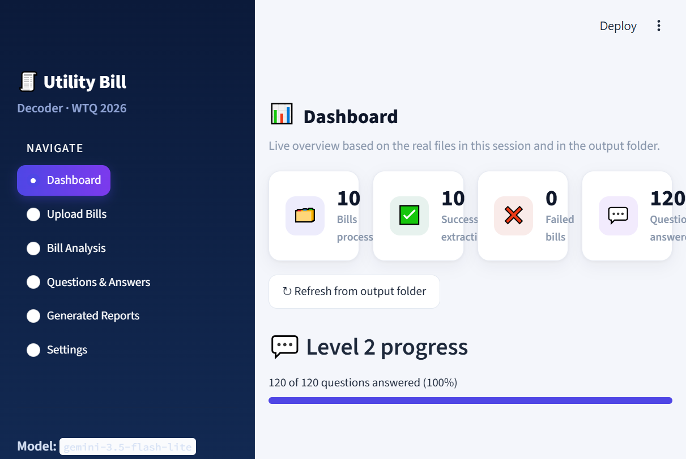
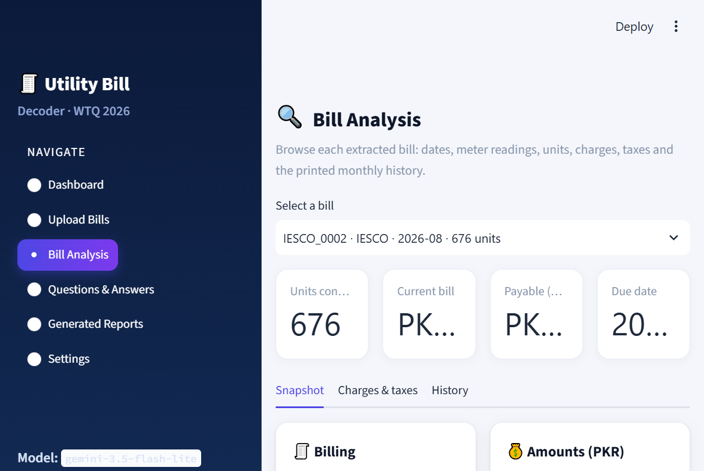
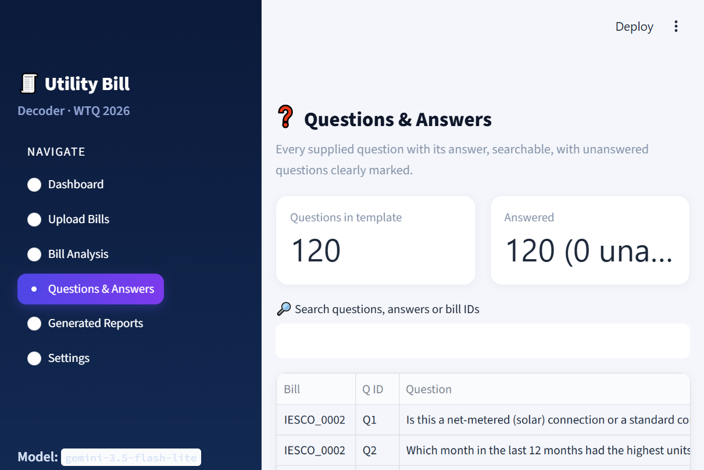
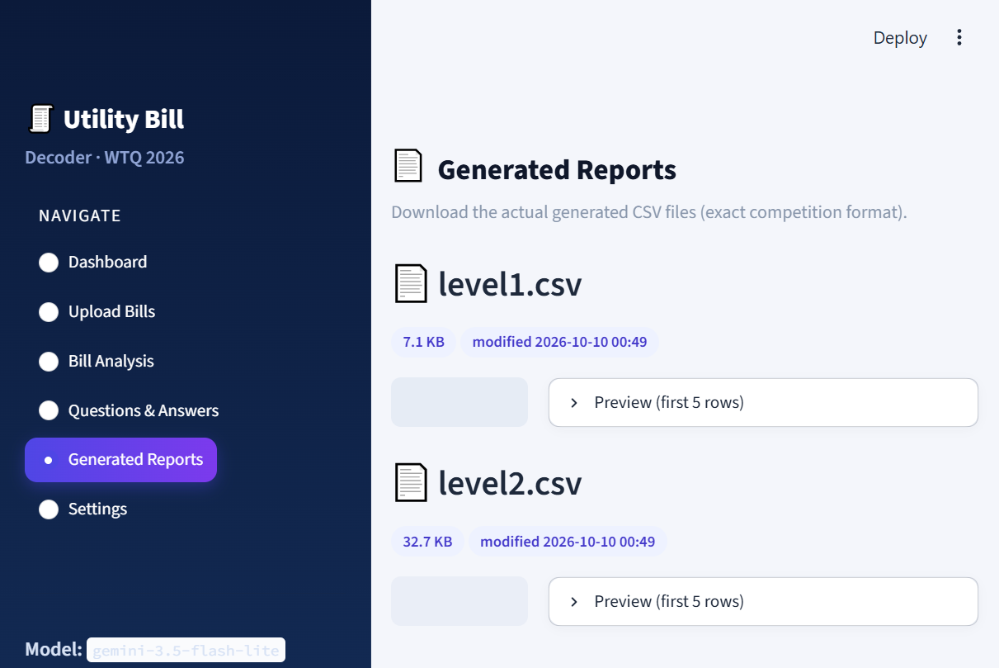
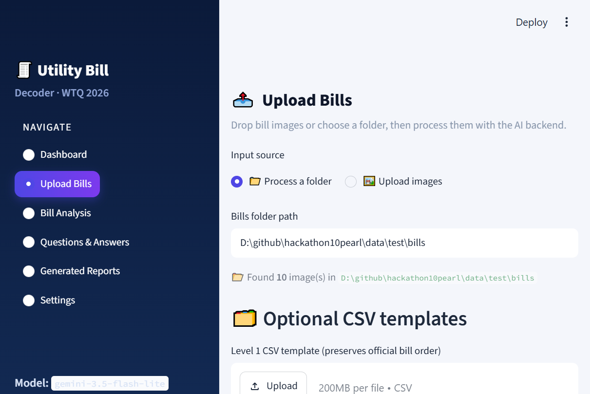
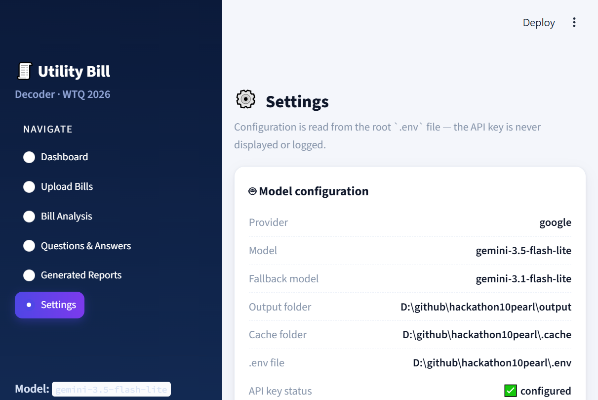

# 🧾 Utility Bill Decoder

**AI that reads Pakistani electricity bills** (K-Electric / KESC, LESCO, IESCO)
from images — scans, phone photos or screenshots — validates every number, and
answers customer questions in plain English.

Built for the **Women Tech Quest 2026 · Build with AI stream** (10Pearls,
Lahore) and turned into a polished **Streamlit dashboard** for anyone to use.

   

---

## ✨ What it does

- **Level 1** — extracts a structured JSON per bill: provider, billing month,
  meter readings, units, charges, taxes, arrears and payable amounts
  (`output/level1.csv`).
- **Level 2** — answers every customer question about the bill in a readable
  sentence, grounded in the extracted values (`output/level2.csv`).
- **Dashboard** — a six-page Streamlit app: upload bill images, inspect every
  extracted field, browse Q&A, and download the generated reports.

Numbers are always taken **as printed on the bill** — never recomputed by the
model. All arithmetic happens in deterministic Python, so results are
reproducible and auditable.

## 📸 Screenshots

| | |
| --- | --- |
|  |  |
|  |  |
|  |  |

## 🚀 Quickstart (5 minutes)

```bash
# 1. Clone and set up
git clone <your-repo-url> utility-bill-decoder
cd utility-bill-decoder
python -m venv venv
venv\Scripts\activate            # Windows
# source venv/bin/activate       # macOS / Linux

pip install -r requirements.txt

# 2. Add a free Google AI Studio API key
copy .env.example .env           # Windows
# cp .env.example .env           # macOS / Linux
# -> edit .env and set GEMINI_API_KEY=<your key>
```

**Option A — see it instantly in the dashboard:**

```bash
streamlit run app.py
```

**Option B — run the AI pipeline on the bundled demo bill** (CLI):

```bash
python run.py --bills sample/bills --out output \
    --level1-template sample/csv/level1.csv \
    --level2-template sample/csv/level2.csv
python tools/check_output.py --output output --level2-template sample/csv/level2.csv
```

You will see one real AI extraction + 12 grounded answers for the demo bill.
Every result is cached on disk, so re-runs are **instant and free**.

> The official competition bills are intentionally **not** in this repo. Use the
> bundled `sample/bills/KESC_DEMO.png` (regenerate it any time with
> `python tools/make_sample_bill.py`) or your own bill images — PNG/JPG/WEBP/BMP.

## 💡 Features

- **Vision-LLM extraction** — reads Urdu text, tilted scans and three different
  utility layouts (K-Electric, LESCO, IESCO) straight from the image; no OCR
  service required.
- **Values as printed** — extract, don't calculate. Suspicious values are
  flagged with *advisory warnings*, never silently "fixed".
- **Deterministic math in code** — per-unit cost, tax share, history averages
  and the flat-English answers are computed from the validated numbers.
- **PII-safe** — names, addresses, reference and meter serial numbers are
  deliberately excluded from all outputs.
- **On-disk cache** — model calls are keyed by prompt + image + model, so
  re-runs are free and reproducible.
- **Batched Level 2** — all questions for one bill are answered in a single
  model call (free-tier friendly).
- **Multi-provider** — Google Gemini primary with an automatic fallback model;
  optional OpenAI / Anthropic support through the same interface.
- **Portfolio-grade dashboard** — navy/light fintech theme, real data only, no
  hardcoded stats.

## ⚙️ How it works

```
bill image
   |  1. preprocess: EXIF rotate, upscale, optional deskew         (Pillow)
   v
   |  2. vision extraction -> one "bill understanding" JSON         (Gemini)
   |        Level 1 fields + monthly consumption history
   v
   |  3. validate + normalize: numbers, dates, signs, nulls          (code)
   v
   |  4. compute facts: averages, shares, counts, estimates          (code)
   +--> 5. output/level1.csv
   |
   |  6. answer all questions in ONE batched call per bill          (Gemini)
   |        grounded in the normalized JSON + computed facts
   +--> 7. output/level2.csv
```

**Design principle: the model reads and explains, the code does the maths.**
A multimodal model is used only for *perception* (reading layouts, Urdu text,
numbers) and *explanation*. Every calculation is Python, so answers are
deterministic; the model is never asked to add or multiply.

## 🧰 Tech stack

| Layer | Choice |
| --- | --- |
| Language | Python 3.11+ |
| Web app | Streamlit + Plotly + pandas |
| Vision / LLM | Google Gemini (`gemini-3.5-flash-lite`, fallback `gemini-3.1-flash-lite`) via `google-genai` |
| Optional LLMs | `gpt-5-mini` (OpenAI), `claude-haiku-4-5` (Anthropic) |
| Image handling | Pillow (EXIF rotate, upscale, optional deskew) |
| Validation | pydantic-based schema + internal-consistency rules |
| Tests | pytest (`23` tests, no API key required) |

## 🔬 Results & validation

During the hackathon the pipeline processed the **10-bill official test set**:
**10/10 bills extracted and 120/120 questions answered**, and the fixed outputs
were submitted in the official CSV format.

On the training set, every "suspicious" value was double-checked with a second
focused model read:

| Bill | Verify result |
| --- | --- |
| KESC_0008 | **Matches the guide's official JSON field-for-field** |
| KESC_0004 | 4-register TOU meter — readings correctly `null`; arrears `-91877.02`, payable `0` confirmed |
| IESCO_0004 | FPA/subsidy lines and payable `3535`/`3812` confirmed |
| LESCO_0005 | Bill genuinely prints negative history units; payable `54770CR` → `-54770` |
| LESCO_0006 | Charges + taxes reconcile exactly (`5501`) |

Verified outputs ship with the repo in `output/level1.csv` (10 bills) and
`output/level2.csv` (120 answers) — exact competition format.

## 🧭 Repository layout

```
run.py                     CLI: folder of bills -> output/level1.csv + level2.csv
app.py                     Streamlit dashboard (six pages)
dashboard/
  styles.py                CSS: navy sidebar, light background, cards
  components.py            UI building blocks (cards, empty states, tables)
  plots.py                 Plotly charts from real extracted data
  state.py                 Session state (records, failures, log)
  io.py                    Temp uploads, reading generated CSVs/artefacts
  pipeline_ui.py           Glue: calls billdecoder, writes output files
billdecoder/               Core backend (provider-agnostic, cache, schema)
  extract.py               Image -> normalized bill object
  normalize.py             Numbers, dates, signs, null handling
  validate.py              Internal-consistency warnings
  calc.py                  Deterministic calculations
  level1.py / level2.py    Official CSV builders
  llm.py / cache.py        Multi-provider client + on-disk cache
  prompts.py               Extraction & Q&A prompts
tools/
  check_output.py          Validates the generated CSVs
  verify_bill.py           Second-pass read of specific fields
  package_submission.py    Builds a competition ZIP
  make_sample_bill.py      Generates the synthetic demo bill + templates
  rebuild_dashboard_data.py Rebuilds dashboard artefacts from the cache
sample/                    Demo bill + Level 1/2 templates (no private data)
output/                    Generated level1.csv / level2.csv (verified)
docs/screenshots/          Images used in this README
tests/                     Unit + dashboard smoke tests (no API key)
```

## 🖥️ Dashboard pages

| Page | What you can do |
| --- | --- |
| **Dashboard** | Live stats from your session + `output/`: bills processed, extraction success, questions answered. |
| **Upload Bills** | Drag & drop bill images (previews), or point at a bills folder. Optional Level 1 / 2 CSV templates. "Process bills" runs real extraction with a progress bar and log. |
| **Bill Analysis** | Every field of a selected bill: dates, readings, units, charges, taxes, payable amounts + the printed monthly history (bar chart & table). Missing values show *Not available* — nothing is invented. |
| **Questions & Answers** | Searchable table of every question + answer; unanswered questions clearly marked; in-page answer generator. |
| **Generated Reports** | Real download buttons + previews for `output/level1.csv` / `level2.csv`, and regeneration from processed bills. |
| **Settings** | Model config from `.env` (key status only — the key itself is never shown) + "Test API connection". |

## 🧪 Development

```bash
pytest -q                      # 23 tests, no API key needed
python tools/check_output.py   # validate generated CSVs
```

The GitHub Actions workflow (`.github/workflows/ci.yml`) runs the full test
suite on Python 3.11 and 3.12 on every push.

## 🔐 Environment variables

See `.env.example`. You only need the one API key for your provider.

| Variable | Purpose | Example |
| --- | --- | --- |
| `MODEL_PROVIDER` | `google`, `openai` or `anthropic` | `google` |
| `MODEL_NAME` | Primary model ID | `gemini-3.5-flash-lite` |
| `FALLBACK_MODEL_NAME` | Backup model ID | `gemini-3.1-flash-lite` |
| `GEMINI_API_KEY` | Google AI Studio key | — |
| `OPENAI_API_KEY` | Optional | — |
| `ANTHROPIC_API_KEY` | Optional | — |

> The API key lives only in your local `.env` (gitignored). It is never printed,
> logged or included in generated files.

## 📝 Notes & assumptions

- Grey-boxed / unreadable values are returned as `null` rather than guessed.
- Credits and subsidies are negative (as the competition guide requires).
- Advisory warnings appear when printed amounts don't reconcile (e.g. bills
  that print `total_charges` excluding the fuel-price line) — values stay **as
  printed**, the warning is for the reader.
- No external extraction services (Azure, Textract, Mindee, …) are used.

## 🗺️ Roadmap

- PDF uploads (render pages to images before extraction)
- More utilities: FESCO, MEPCO, GEPCO, SEPCO, HESCO, QESCO
- Multi-page bill support and year-over-year comparison charts
- Deploy the dashboard with a managed cache (tips: Streamlit Community Cloud)

## 📄 License

MIT — see [LICENSE](LICENSE). Created by **Swaira Imran** for the WTQ 2026
hackathon with the allowed-model rule in mind. Questions are welcome! ✨